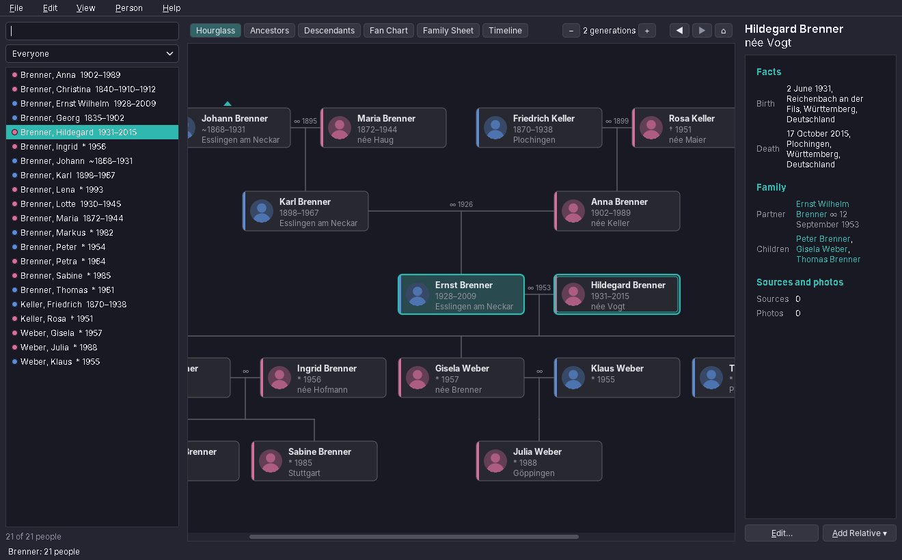
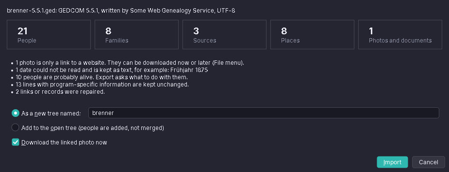
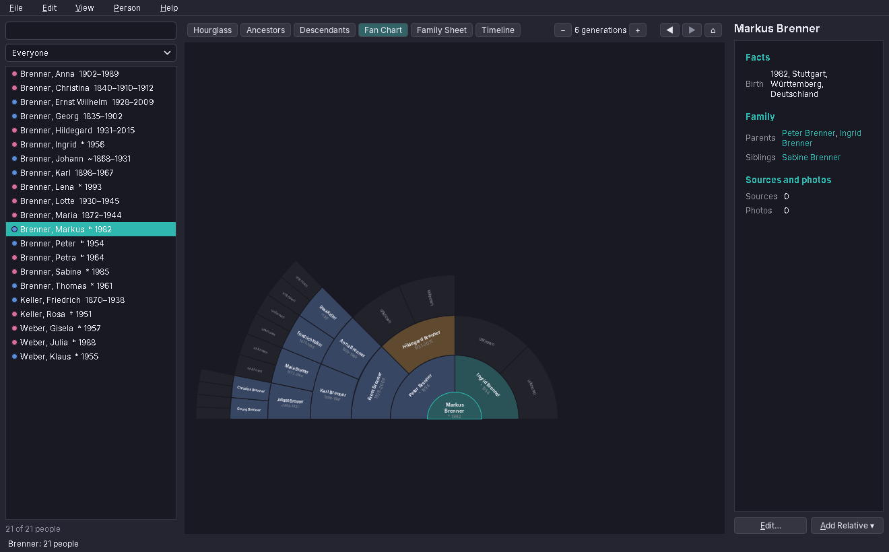
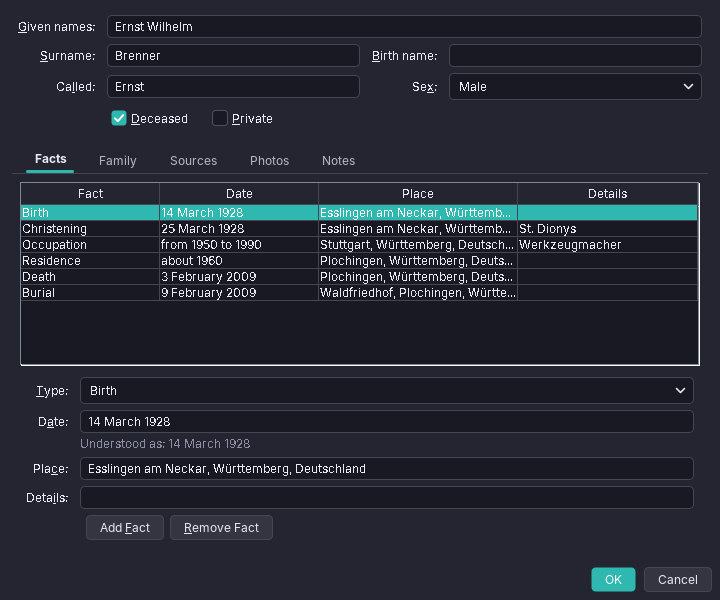
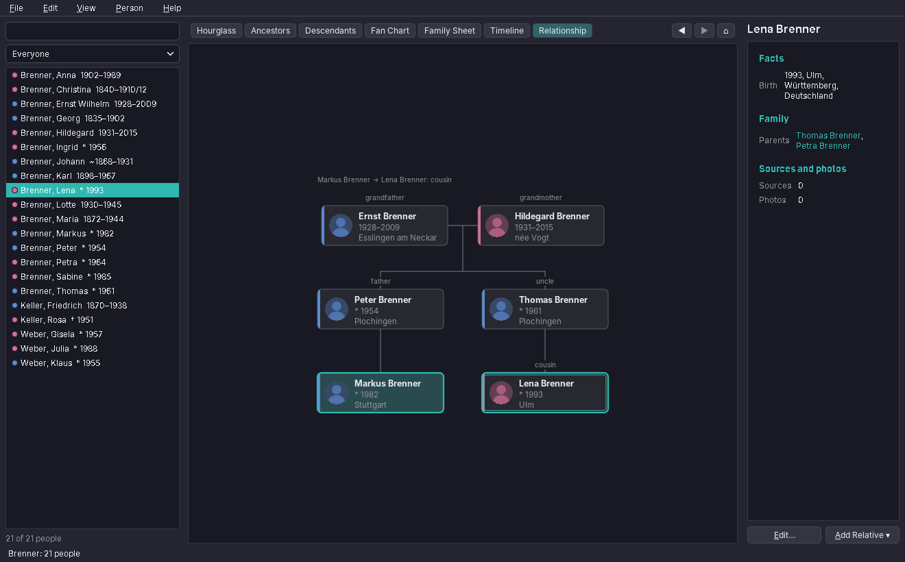

# amade-familytree

**amade-familytree** (Family Tree) is the genealogy program of the [amadeOS](https://github.com/amadeos-eu/amadeos) desktop. It shows and records family trees: ancestors and relatives with dates, places, sources, notes and photos, as hourglass, ancestor, descendant and fan charts, as a family sheet and as a timeline. It reads and writes GEDCOM, the exchange format of genealogy programs and websites, so a tree exported elsewhere can be carried on here. Built like the other amadeOS applications.




## Features

- **GEDCOM import**: GEDCOM 5.5.1 and 7.0 (`.ged`) and GEDZIP with photos (`.gdz`, also a `.zip` with a `.ged` inside); UTF-8, UTF-16, ANSEL and Latin-1. Before importing, a page shows what the file holds (people, families, sources, places, photos), which dates could not be read (they are kept as text, nothing is lost), how many people are probably alive and what was repaired. A file can become a new tree or be added to the open one.

  
- **Nothing is lost**: tags the program does not know (`_UID`, `_MARNM`, `_PRIM` and other program-specific lines) are kept and written back unchanged.
- **Photos**: many websites export photos only as links. *File → Download Linked Photos* fetches them into the tree's `media` folder (through the amadeOS proxy setting); *Find Photos in a Folder* matches photos you saved yourself by file name.
- **Views** (Ctrl+1 to Ctrl+7): *Hourglass* (ancestors above, partners and descendants below), *Ancestors*, *Descendants*, *Fan Chart* (the four grandparents' lines in their own colours, empty places show where research can go on), *Family Sheet*, *Timeline* (the person's events with those of parents, partners and children, and the age at each) and *Relationship*. More or fewer generations with Ctrl+Page Up/Down, zoom with Ctrl+Plus/Minus, Back and Forward like a browser.

  
- **Person editor**: given names, surname, call name, birth name, sex, deceased, private; facts (birth, baptism, occupation, residence, emigration, death, burial and all other GEDCOM events and attributes) with date, place and details; marriages; sources with page; photos with a portrait; notes. Dates are typed the way people write them, in any of the five languages (`um 1890`, `before 1900`, `entre 1850 et 1855`, `14.03.1928`), and the editor says how it understood them.

  
- **Add relatives** from the selected person (father, mother, partner, son, daughter, brother, sister; the surname is filled in) or connect an existing person. Every change is saved at once and can be undone (Ctrl+Z, Ctrl+Y).
- **Search** by name, place or year; names that sound alike are found too (Cologne phonetics: *Meyer* finds *Maier*). The list can show everyone, the same surname, ancestors or descendants of the person in the middle, people without parents, people who are probably alive, or people with dates kept as text.
- **Relationship** view (Ctrl+7): the way from you (the home person) to the person you click in the list, like a route: the nearest common ancestors at the top, your line down on one side, theirs on the other, each person captioned with what they are to you (*grandfather*, *uncle*, *cousin*, *daughter-in-law*). A double-click starts the way at someone else. Ctrl+R names the relationship in a message: *great-great-grandmother*, *second cousin once removed*, *Schwager*, *arrière-grand-oncle*.

  
- **GEDCOM export** as 7.0, 5.5.1 (for older programs) or GEDZIP with photos. People marked private are always left out; people who are probably alive (born less than 110 years ago, no death) can be written in full, shortened to surname, sex and family links, or left out.
- **Print** the chart or page, or save it as a PNG picture.
- Five languages (English, Deutsch, Français, Español, Italiano), following the amadeOS desktop language; *Options → Language* overrides it.
- Theme colours, Motif and Horizon look from [amade-commons](https://github.com/amadeos-eu/amade-commons).

### Where the trees are

Each tree is a folder in *Documents/Family Trees* (in the desktop language: *Stammbäume*, *Arbres généalogiques*, …) with the tree as a GEDCOM 7.0 file, a `media` folder for photos and documents and a `backups` folder: the first change of each session keeps a copy of the file before it, the last ten copies stay. Any other genealogy program can read the file.

### Keys

| Key | Action |
|---|---|
| Ctrl+N, Ctrl+O | New tree, open a tree |
| Ctrl+I, Ctrl+E | Import, export GEDCOM |
| Ctrl+1 … Ctrl+7 | Hourglass, Ancestors, Descendants, Fan Chart, Family Sheet, Timeline, Relationship |
| Ctrl+Page Up/Down | More or fewer generations |
| Ctrl+Plus, Ctrl+Minus, Ctrl+0 | Zoom |
| Alt+Left, Alt+Right, Alt+Home | Back, Forward, home person |
| Ctrl+M | Put the selected person in the middle (also: double-click) |
| Ctrl+Enter | Edit the person |
| Ctrl+Shift+P | Add a partner |
| Ctrl+L | Connect an existing person |
| Ctrl+R | Relationship to the home person |
| Ctrl+F | Find a person |
| Ctrl+Z, Ctrl+Y | Undo, redo |
| Ctrl+P | Print |
| F1 | Handbook |

## Platforms

Linux (deb), the amadeOS desktop. The program is plain Java and Swing and also runs elsewhere from the jar.

## Architecture

Java 25, Swing and Guice; start-up, theme and language come from `AmadeApplication` in amade-commons.

| Package | Contents |
|---|---|
| `bootstrap` | `AmadeFamilyTreeApplication` (a GEDCOM file as argument is imported), `FamilyTreeModule`, `Windows` |
| `gedcom` | `GedcomNode` (the line tree), `GedcomReader` (charsets, ANSEL, CONT/CONC, lenient lines), `GedcomWriter`, `GedcomConverter` (5.5.1 ↔ 7.0), `Ansel` |
| `domain` | `FamilyTree` (records, building, normalising, merging), `Person`, `Family`, `Fact`, `FactType`, `PersonName`, `Citation`, `SourceRecord`, `MediaRecord`, `GenDate`, `DateText`, `Relationship`, `Living`, `Search` |
| `repository` | `FamilyTreePreferences` (`~/.config/amadeos/familytree/familytree.properties`: last tree, home person per tree, view, generations) |
| `service` | `TreeStore` (folders, safe saving, backups), `GedcomImport` (report, GEDZIP), `GedcomExport` (formats, living and private people), `PhotoDownloader`, `Undo`, `DesktopOpener` |
| `ui.main` | main window, presenter, menus, person list |
| `ui.chart` | `TreeLayout` (hourglass, ancestors, descendants, relationship), `ChartPanel`, `FanChart`, `BoxPainter`, `Portraits` |
| `ui.text` | `Pages` (family sheet, timeline, summary), `RelationshipText`, `Texts` |
| `ui.edit`, `ui.dialogs` | person editor; import, export, trees, person chooser, progress |

The tree is kept as GEDCOM lines in 7.0 form; `Person`, `Family` and the others are views on those lines, so whatever the program does not understand stays in place. Each change is an undo step that copies the records it touches before the change. The presenter knows the window only through the `MainView` interface, so the tests drive opening, importing, editing, undo and export without Swing.

## Build and run

```sh
./gradlew run                                         # the tree used last, or the welcome page
./gradlew run --args="Downloads/family.ged"           # import a GEDCOM file, as from Files
./gradlew test                                        # Swing tests need a display: xvfb-run ./gradlew test
./gradlew deb                                         # build/distributions/amade-familytree_<version>_all.deb
./gradlew installToAmadeOs                            # the .deb into ../amadeos/config/packages.chroot/ for the ISO build
```

If `../amade-commons` is checked out next to this repository, Gradle builds against that checkout instead of the published version.

## Planned

- Merging two people who are the same (after adding a file to an open tree)
- Places with coordinates on a map
- Reports as PDF: ancestor list with numbers (Kekulé), descendant report, family book
- More than one portrait per person in the charts, and photo regions (who is who on a group picture)
